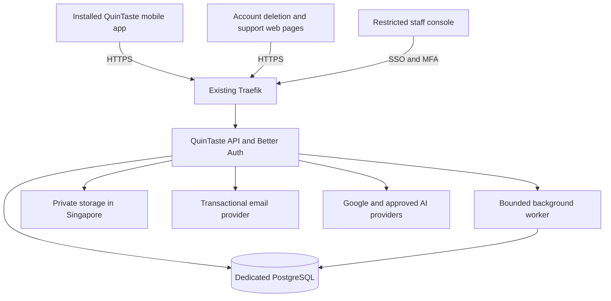

> **16 October avatar production update:** The avatar service now has a dedicated authenticated Cloudflare integration, encrypted temporary payloads and PostgreSQL jobs/budgets. Current deployment and acceptance evidence are in [AVATAR_PRODUCTION.md](AVATAR_PRODUCTION.md). This supersedes historical statements below that avatar generation is development-only or requires an OpenAI key on the VPS. Other AI/phase gates remain unchanged.

**16 October customer Google login and master usage:** [Current Google sign-in, Expo Go handoff and pinned owner policy](GOOGLE_LOGIN.md) supersede earlier username-only/no-Google instructions and the owner's standard avatar quota. Regular member quotas are unchanged.

# QuinTaste VPS and production readiness

## 16 October admin deployment update

The separate staff console is deployed at https://admin-quintaste.srv1902914.hstgr.cloud/ with healthy HTTPS/app/database checks. Implemented controls and bounded security evidence are recorded in [ADMIN_PLATFORM.md](ADMIN_PLATFORM.md). The Google client ID is configured, but the Google client-secret and Cloudflare Run-token files were empty at verification. Live Google/security-key sign-in and OpenAI connection acceptance are therefore pending. Identity evidence intake, full source publication, customer report wiring, incident notification delivery and later-phase production services remain incomplete. This update supersedes the earlier statement that no staff console exists; it does not certify the whole product for production. The owner selected the existing Malaysia VPS and username/password recovery codes, superseding the older Singapore/email assumptions below.

## 16 October admin-console PRD review

The owner proposed an admin page for application management and private API-key entry. Checked the original PRD Edition 1.4 and screen supplement against `server/auth.mjs`, `server/index.mjs`, the Compose services and `/local-review`. This is a design assessment, not an implemented console or changed server permission boundary.

| Requirement | Source | Current gap |
| --- | --- | --- |
| Separate staff console, SSO, phishing-resistant MFA, role scopes, privileged-change reasons and audit log | QT-071, PRD p38; stack specifies Next.js on p54 | Current Better Auth setup provides consumer username sessions, not staff SSO/MFA/roles. |
| Food claims, editorial corrections and content withdrawal | QT-070, PRD p38 | Development catalogue/case review exists; production ownership and publication controls remain incomplete. |
| Reports, harm notices, content/account restrictions and case evidence | QT-026, PRD pp20–21; QT-080, pp38–39 | The local reviewer tool is not a production staffed queue; its API routes are blocked on the VPS. PRD response times are proposed product targets, not a legal determination in this review. |
| Incident ownership, feature shutdown, member communication and restoration | QT-073, PRD p38; QT-082, p39 | Current hosting/backup controls do not provide the required operational console or completed drills. |
| Case-scoped staff access, without unrestricted personal-data access or unrecorded reward changes | PRD role table p40 | Needs server-enforced staff permissions and protected audit records. |
| ID review with reasoned decisions, logged views, no export/download function and image deletion after decision | QT-089, PRD p22; N21-03, supplement p24 | Phase 2 scope, not a prerequisite for enabling basic username signup. No production review/media lifecycle exists. |

Proposed implementation: a separate Next.js staff web service on this VPS, behind HTTPS and staff SSO with phishing-resistant MFA. Use a distinct staff session boundary, explicit staff invitations and backend permissions; a consumer account or a hidden admin URL never grants administration. Candidate address `admin-quintaste.srv1902914.hstgr.cloud` is a proposal only and has not been provisioned. The console can share existing infrastructure while keeping staff identity and privileged API authorization separate. The public app's username/recovery-code choice remains intact and does not remove the PRD's stronger staff-authentication requirement.

First delivery should cover restricted owner access, limited account/session support, service/usage status, feature controls and reasoned audit records. Add real editorial/case queues before enabling corresponding public submissions. ID review, marketplace decisions and game reward operations stay tied to their later feature/service gates. Avoid broad personal-data browsing and never expose account password or recovery-code values to staff.

An owner-only Integrations area is a new operational extension prompted by the owner, not an explicitly drawn PRD screen. It should expose provider/key references, configured status, last verification time, restricted connection checks, rotation/removal actions, usage limits and an emergency disable control. Responses and audit events must exclude credentials and request bodies containing them. A status check must distinguish credential presence from successful authenticated provider access; generation tests can incur charges.

An admin form alone does not prevent an agent with root or deployment access from reading credentials: the agent could inspect the receiving process, retrieve the decryption key or modify the form/backend. Python encryption or hashing does not fix this privilege boundary. Hashes cannot replace a provider's required bearer key; reversible encryption needs a protected decryption capability.

For the owner's stronger requirement that the coding assistant cannot retrieve the OpenAI key, enter it directly in an independently controlled secret/gateway interface, outside assistant-accessible administration and code deployment. The application calls a restricted gateway that injects the upstream key and returns only provider results; it must never return the key. The app admin page manages non-secret references and status, and links to the protected credential-entry interface. Restrict model/operation access, budgets and gateway credentials as these still authorize spending. Keeping the gateway on the same host while retaining assistant root access would not create this separation. Credentials for its management plane must also remain outside the assistant's tools, shell and browser access. [Cloudflare BYOK](https://developers.cloudflare.com/ai-gateway/configuration/bring-your-own-keys/) is an existing example of stored provider keys and aliases; selecting it would still require checking image-edit compatibility, privacy/logging configuration and the [account-wide scope of gateway Run tokens](https://developers.cloudflare.com/ai-gateway/configuration/authentication/).

All of this review remains local. No admin route, gateway, secret-entry page, permission revocation or production AI activation was deployed during the assessment. Existing Malaysia/VPS direction remains unchanged; the original PRD's Singapore residency and AI-provider architecture are not silently claimed as satisfied by this design.

**16 October OpenAI review:** The VPS has no OpenAI key and generation remains disabled. Existing image-provider code is a development pilot, not a production ChatGPT integration. Account authorization, durable jobs/budgets, scoped image uploads/storage and live-model acceptance remain outstanding; [OPENAI_SETUP.md](OPENAI_SETUP.md) records the exact key location and evidence. All project documentation stays local and is excluded from release packages/images.

**16 October username override:** At the user's request, username/password signup replaces email verification, and saved one-time recovery codes replace email password recovery. Email delivery is no longer a launch dependency for this chosen flow. This does not resolve the previously identified dependency advisories, missing web CSP, off-server backups, security monitoring or release-build acceptance. See [current deployment controls](VPS_DEPLOYMENT.md); earlier email requirements below are historical.

**16 October deployment update:** The isolated VPS staging stack is now implemented; see [deployment and operations](VPS_DEPLOYMENT.md). Better Auth email/password sessions, account profile/export/deletion, a dedicated PostgreSQL database and a remote Expo Go preview replace the earlier local-only identity boundary when EXPO_PUBLIC_AUTH_ENABLED=true. Public registration/recovery still need SMTP configuration; Apple/Google, cloud food sync, production moderation and native acceptance remain incomplete. The audit below records the pre-deployment findings and must not be read as claiming the newer implementation has completed every production requirement. The user selected Malaysia, then instructed proceeding without further location verification; no VPS migration was performed.

Audit date: 16 October 2026, Singapore time. Target: `srv1902914.hstgr.cloud`.

The VPS can support a staging deployment and is a plausible starting point for a small pilot. Capacity under concurrent app traffic is unmeasured. QuinTaste currently has local preview accounts and device collections, not production authentication or shared application services. The recommended foundation is an installed mobile preview build, an HTTPS API using the existing Expo Router server structure, Better Auth, and a dedicated PostgreSQL database. The same foundation can support the planned cooking game later.

This assessment used read-only SSH inspection, the current source, the supplied PRD Edition 1.4 and screen supplement, current AGENTS.md overrides, and official documentation. No VPS configuration, service, firewall, database, or deployment was changed. The only authored project artifact is this report.

## Observed VPS state

| Item | Observation | Deployment implication |
| --- | --- | --- |
| Operating system | Ubuntu 24.04.4 LTS | Existing Linux deployment platform is suitable. |
| CPU | 2 virtual cores | Build images in CI and bound worker concurrency; other applications share these cores. |
| Memory | 7,940 MiB total; approximately 4,900 MiB available at inspection | Enough headroom to investigate a small dedicated app stack; this is a snapshot, not a peak-load guarantee. |
| Swap | None | Memory spikes need particular attention. |
| Root disk | 96 GiB filesystem; approximately 52 GiB available | Allow for databases, media, logs, backups and image retention. |
| Running containers | 19 across several applications | Deploy QuinTaste as its own Compose project, network, credentials and volumes. |
| Existing services | Docker, Traefik on 80/443, PostgreSQL, Redis and another application's reduced Supabase stack | Reuse operational patterns; give QuinTaste separate application data and credentials. |
| Host firewall | UFW inactive | Review effective host and Docker firewall rules, plus the Hostinger firewall, before exposure. UFW status alone does not establish the state of other firewalls. |
| Reachability | TCP 80, 443, 3000, 3001 and 32773 were reachable at the public address from the audit machine | Review direct application ports; restrict those that are not intended to bypass Traefik. Do not change them without checking existing service requirements. |
| Maintenance | Reboot required after kernel/libc updates | Plan maintenance with checks for every existing application. |
| Backups | Backup and restore-drill timers exist for another application | This does not establish QuinTaste backups, a general VPS restore, or Hostinger snapshot coverage. |
| Hosting region | Cloud-init reports no region or availability zone | Confirm Singapore in the provider control panel before hosting production personal data here. GeoIP and hostname do not establish physical residency. |

Hostinger firewall policy, provider backup retention, physical server region, and peak resource demand remain unverified. If this VPS is outside Singapore, choose Singapore infrastructure for the personal-data backend before proceeding with real accounts. A Singapore database alone does not settle residency for an API processing personal information elsewhere.

## Recommended setup

All personal-data components and their backups must satisfy the PRD's Singapore residency requirement. Provider-specific processing and transfers need their own assessment; this diagram does not establish that an external service meets it.

| Component | Recommended starting point |
| --- | --- |
| Mobile application | EAS development build for native debugging, then an installed preview/release build for acceptance. Android APK/internal testing and iOS ad hoc/TestFlight are distribution options subject to their respective accounts and provisioning. |
| API | Preserve Expo Router API routes and modular `src/server` services. Export the production server and use the supported Node adapter behind Traefik. Avoid maintaining two separate implementations of domain logic. |
| Authentication | Better Auth with its Expo integration and dedicated PostgreSQL tables. This follows the PRD's open D19 recommendation; Cognito is the stated fallback if the team will not own authentication operations. |
| Database | Dedicated QuinTaste database, restricted application role, migration history, persistent storage and restore procedure. No public database port. |
| Media | Private Singapore object storage with limited upload permissions, signed access, metadata stripping and deletion rules. Public, rights-cleared media should have a separate publication path. |
| Staff tools | Separate restricted console, SSO, phishing-resistant MFA, role-scoped decisions, reasons and an audit trail. The local reviewer key is not a production staff identity system. |
| Background tasks | Start with a bounded worker and durable jobs in PostgreSQL. Introduce a separate queue service only when workload evidence warrants it. |
| Email | A configured transactional provider for verification, password reset and security notices; validate domain authentication and actual delivery. Marketing consent stays separate. |
| Deployment | Separate staging and production configuration, secrets, databases and media. Use pinned images, health checks, restart policies and rollback-capable releases. |
| Operations | Uptime/error monitoring, CPU/memory/disk alerts, provider usage alerts, encrypted off-host backups, restore drills and documented incident owners. |

A full additional Supabase deployment is not the first choice on this shared host. Its published complete-stack minimum is 4 GB RAM and 2 CPU cores, with 8 GB+ and 4 cores+ recommended. Better Auth plus PostgreSQL fits the PRD direction and avoids adding services the app does not yet need. Reassess the decision if the team chooses managed authentication instead.

Use public HTTPS hostnames on a controlled domain for the API, staging, staff access, recovery links and deletion page. Register exact OAuth callback URLs and distinct mobile schemes/application identifiers for staging and production. Final hostnames and provider registrations are not configured.

An initial combined API/database/worker memory envelope around 1.5–2.5 GiB is a planning estimate to validate, not reserved capacity. Existing containers can grow well beyond their current use. Measure combined peak load and preserve headroom for the other applications. Build mobile binaries and container images outside this two-core server.

## Current implementation and required work

| Area and PRD reference | Current evidence | Required for production acceptance |
| --- | --- | --- |
| Guest access — QT-001, J16, pp11/41 | Explore works without registration. | Preserve guest browsing/manual search. Ask for sign-in at a consequential account action and return to the original task. |
| Identity — QT-067, J16, pp36/41; D19 p48 | `usePreviewAuth.ts` validates example inputs, clears credentials and opens a local preview. Google/Apple buttons report that they are not connected. | Real signup/sign-in, verified email, password recovery, secure persistent sessions, logout/revocation, account switching, safe provider linking, Google and Apple, and a passkey path validated on supported devices. Roll providers out deliberately; finish the agreed account scope before claiming QT-067 complete. |
| Adult eligibility — QT-079, p37 | Local DOB validation and an adult flag exist; no production enforcement. | Validate eligibility on the server; retain only the required adult result from the DOB step. Review current store age controls and supported platform age APIs. Account creation is not verified identity or permission to host. |
| Profiles and preferences — QT-065/067, p36 | Display name, bio and preferences are stored locally. | Persist profiles against the authenticated user ID; separate public profile projection from private preferences and service-only fields. Keep Social visibility and AI consent independent. |
| Account ownership and cloud saves — QT-011/067, pp16/36 | `useFoodStorage.ts` has only `guest` and `profile` cache keys. | Scope caches by real user ID, authorize every server operation from the validated session, and clear private views on switching. Add versioned cloud saves/lists/notes and explicit conflict/retry behavior. Two real users must never share the current generic profile cache. |
| Guest migration — J16, p41 | Guest-to-preview copy is explicit and local. | Preview the intended import, preserve originals, enforce ownership, make repeated import idempotent, resolve conflicts, and return to the task after successful sign-in. Do not upload every local collection automatically. |
| Private places — QT-011/012, p16 | Home/Work and precise coordinates live in the device collection; sharing is bounded. | Preserve device-first behavior unless cloud storage is explicitly selected. Any server copy needs authenticated ownership and the approved privacy/retention rules. Saving a private address must not enable community participation. |
| Support and corrections — QT-066/080, pp36/38–39 | A development-only service issues local cases and reviewer outcomes. | Durable authenticated intake, attachments, receipts, status/history, reviewer access and accountable response operations. A local reference is not evidence of production delivery or resolution. |
| Export/deletion — QT-067, p36 | `Privacy.tsx` exports local text and deletes a local collection/development records. | Authenticated server export, in-app and web account-deletion request paths, recent-authentication checks, session/provider revocation, content/media/job cleanup and accurate retention disclosures. Test recovery and deletion across devices. |
| Backend production gates — QT-071/073, p38 | Local Explore and avatar services explicitly require `NODE_ENV=development`. | Create authenticated production services and independent module controls. Keep production in production mode; do not expose development mode to bypass the existing gates. |
| Discovery and catalogue — QT-005–010/070/076/077/081/083; Phase 1 pp10/45 | Live provider features and selected public menus exist. This is not the complete reviewed PRD catalogue. | Approved pilot content, rights and evidence workflow, correction/withdrawal handling, truthful unknowns and offline behavior. Preserve the latest venue-first Explore and Menu composition overrides. |
| Provider budgets | Google requests depend on ignored `.local/places-allowance.json` and a file-backed usage ledger; some rate windows are process-local. | Explicit production allowance configuration, persistent and concurrency-safe accounting, failure behavior and alerts. Do not reset provider usage during deployment or treat a per-process limiter as a global multi-instance budget. Development Google photo-cache permission does not authorize production photo storage. |
| Avatar AI — experiment track and current avatar override | OpenAI image requests have key/enable/device gates, fixed models, consent and a durable local allowance; jobs/previews are process-local. | Authenticated account access, HTTPS, approved processing/retention, durable job status and budget accounting, expiry/deletion, cancellation, abuse controls and an accepted live output/cost test. Preserve explicit photo consent. |
| Food-assistance AI — QT-059–064, pp34–35 | Not implemented by the avatar integration. | Keep gated. The PRD specifies separate Singapore processing/provider and safety acceptance; the approved OpenAI avatar experiment does not complete or silently replace those requirements. Re-check current model/region availability before enabling it. |
| Social and Market — current AGENTS.md overrides | Current flows store local records and explicitly simulate counterpart actions. | Shared services need participant authorization, real message delivery, block enforcement, visibility consent, moderation and transaction/capacity correctness. Preserve current People/Events/My plans and pantry-market directions rather than restoring obsolete booking compositions. |
| Privacy and operations — QT-071/073/080/082, pp38–39 | Production staff identity, retention operations and incident process are absent. | Singapore residency, purpose/retention records, restricted staff tools, DPO/contact information, accountable support and harm handling, and incident/restore rehearsals. Revalidate dated legal and store-policy wording before public launch. |
| Native release acceptance — QT-068/069/074, pp36–38; pp45–46 | TypeScript and lint pass; earlier browser/transport evidence is bounded. | Real installed builds, essential journeys, screen readers, large text, camera/location permissions, timers/background behavior, offline recovery and update/rollback compatibility. Bundle delivery is not native acceptance. |

The detailed existing requirement inventory remains in [PRD_COVERAGE.md](PRD_COVERAGE.md). This report does not mark those requirements complete.

## Authentication and profile acceptance checklist

1. A guest can browse public food content without an account or location grant.
2. Signup stores a real user, applies the adult gate, sends verification, and handles duplicate email and provider linking without disclosing unnecessary account information.
3. Verification and password-reset links open the intended staging/production app; expired, replayed and cancelled links recover cleanly.
4. A verified member can sign in, restart the app, refresh a session, sign out, and revoke another session. Password reset and account deletion invalidate the intended sessions.
5. Google and Apple succeed and cancel correctly on installed Android/iOS builds. Passkeys receive their own supported-device and recovery acceptance.
6. Member A cannot read or alter member B's profile, saves, private notes, photos, cases, Social messages or game records by changing an ID, header, link or request body.
7. Switching A → B → guest clears private views and restores the correct per-user cache; late requests cannot populate the next user's screen.
8. Guest import presents what will be copied, handles conflict/failure, and commits once despite retries, interruption or another device.
9. A second device sees authorized profile/saved changes. Offline edits, simultaneous updates, deletions and app upgrades have explicit resolution behavior.
10. Export and deletion cover the account's actual server data, media and queued work, respect retention, and have an operable web deletion route.
11. Rate limits, approved redirects, session expiry, email delivery and staff privilege checks are exercised against the real staging backend.
12. Local preview labels are replaced only where a real production service is implemented; unsupported actions retain truthful availability.

The client must use the backend's authenticated identity. The existing `X-QuinTaste-Owner` guest/profile selection and opaque local session mechanism must not be promoted into production account identity.

## Mobile distribution and laptop independence

Expo Go can continue to serve UI exploration through a private VPS preview service. It should not be the final account/production test environment. Expo documents that OAuth/OpenID flows require a development build when a custom application scheme is needed; native libraries also require a matching custom binary.

Create separate development, staging-preview and production build profiles. Install a preview/release build with its JavaScript and essential assets bundled, pointed at the VPS HTTPS API. That build can run with the laptop off and on mobile data. EAS Update can deliver compatible JavaScript/assets later; native runtime changes still need a new binary. An ordinary development build pointed only at Metro still depends on that Metro server or a compatible published update.

For initial production acceptance, the server should run the exported Node API, not a publicly exposed Metro development server. Validate HTTPS handling through the chosen adapter/proxy, including avatar upload checks; do not bypass the secure-request guard by trusting arbitrary forwarding headers.

## Future game support

The same architecture supports the PRD's Rush Hour game and related profile/cosmetic systems. The current `GameScreen` is an unavailable-state screen, so the following is planned architecture, not existing functionality.

| Responsibility | Location and contract |
| --- | --- |
| Rendering and input | Phone: sprites, animation, sound, heat simulation, drag/select-and-place, pause and accessible station list. No VPS GPU is needed for this planned design. |
| Authenticated game session | API: issue an online attempt with user ID, seed, level/rules version and bounded lifetime. Keep game entitlement separate from Social/Market permissions. |
| Validation | Server/worker: replay a bounded deterministic event log against the issued seed and rules before accepting the result. Do not trust a client-supplied score or balance. |
| Progress | PostgreSQL: per-user learning state, per-mode skill, checkpoints, first clears and unlocked levels. |
| Credits and ownership | PostgreSQL: transactional reward/spend ledger and cosmetic inventory, unique claims, no negative balance, no double spend across two devices. Avatar appearance remains under the same adult account. |
| Offline play | Offline-started games are local practice. An online-started run interrupted by a network failure has pending rewards until the same attempt is validated after reconnecting. |
| Art and content | Versioned, rights-cleared downloadable assets and level definitions; distribute static assets separately from CPU-bound validation when appropriate. |
| Scale | Bound replay work and queue concurrency. Move the validator to a separate worker/host if measured load competes with API or other VPS applications. Real-time multiplayer is outside the current PRD and needs a separate capacity/design review. |

PRD anchors: QT-049–053, p29; QT-054–057, p30; session/offline rules, p32; six-level gate and performance goals, p33; economy validation, p46. Numeric scoring/reward values in the PRD are proposals, not approved balance settings.

Required game acceptance includes duplicate and forged claims, two-device spending, interruption before/after reward commit, version mismatch, replay correctness, no loss of settled inventory, Rush/Calm separation, background pause, accessible non-drag controls and budget-device performance. Validate Levels 1–6 before producing Levels 7–20 art. Server tests cannot establish phone frame rate or control usability.

Add domain boundaries for game sessions, progress, reward transactions and inventory when implementing the feature. The foundational user IDs, database migrations, authorization, jobs and audit conventions should support them now. A second authentication system or separate user identity is unnecessary.

## Recommended delivery order

| Stage | Work | Exit evidence |
| --- | --- | --- |
| 1. Hosting foundation | Confirm Singapore region; review direct ports and firewall policy; schedule reboot; define domains, secrets, isolated Compose project, resource caps, staging database, backups and monitoring. | HTTPS health checks; restart recovery; off-host backup and isolated restore; neighboring services remain healthy. |
| 2. Accounts | Better Auth, verified email, recovery, secure native sessions, profiles, adult gate, provider registration and account-scoped caches. | Authentication checklist passes against staging, including two accounts and two devices. |
| 3. Owned data | Cloud saves/lists/notes, explicit guest import, version/conflict handling, export/deletion and server-authorized review intake. | Retry/offline/switching/deletion journeys pass; unauthorized access fails. |
| 4. Installed build | EAS native configuration, development and preview builds, correct HTTPS origin and callback schemes, native permissions/timers. | Laptop-off/mobile-data run; install, cold start, OAuth, recovery links and real-device accessibility evidence. |
| 5. Core pilot gate | Reviewed pilot content, rights/freshness, support/reviewer operations, privacy notices, staff access, incident/restore drills and agreed load targets. | PRD pp45–46 evidence for the enabled scope; staging success alone is not public production approval. |
| 6. Additional modules | Production Social/Market, avatar pilot expansion and game, each under its own server-enforced flag and acceptance contract. | Module-specific privacy/safety/ownership tests and operational coverage before real public exposure. |

The local five-tab UI remains the current composition. Enable only backend functionality whose production gate is met; preserving a tab does not authorize shared messaging, public sales, identity-document intake or credits.

For Social identity, resolve the production policy before enabling real participants. The current adult self-declaration is not Verified 18+. The PRD's staff-ID workflow (QT-089) includes sensitive evidence, access logging and timed deletion; it is not part of basic account setup and must not be enabled merely because a member signed in. Current Social composition overrides also mean the older Tables booking flow should not be rebuilt automatically.

## Evidence and decisions still needed

- Fresh `npm run typecheck` and `npm run lint` both exited 0 during this audit.
- Existing source includes extensive staged/unstaged/untracked work. Select and record a reproducible reviewed release before deploying; do not publish an unidentified working directory or stage unrelated changes automatically.
- No production account, email delivery, OAuth, cloud sync, security isolation, restore, concurrency or physical-device acceptance was performed here.
- Confirm the Hostinger datacenter, chosen domain, transactional email provider, Apple/Google application registrations and who owns authentication/security operations.
- Agree which modules are included in the first real pilot and the expected concurrent workload. Do not infer a player/user capacity from the current idle resource snapshot.
- Define backup recovery objectives and test them. Daily backups and a four-hour recovery goal are possible initial proposals, not an existing service guarantee.
- Recheck current legal/store requirements with the responsible owner before public release; quoted PRD policy dates and legal assertions are requirements to reconcile, not legal verification by this audit.

## Sources

- [PRD Edition 1.4](../../QuinTaste_Product_Requirements_v1.4.pdf): pp10–11, 16, 28–39, 41, 45–49. Account flow QT-067/J16 and D19 are particularly relevant.
- [Screen supplement](../../QuinTaste_UI_UX_Screen_Reference_v1.4_Missing_Screens.pdf), p2, and [current AGENTS.md](../AGENTS.md) for later explicit composition/scope overrides.
- [Existing PRD coverage](PRD_COVERAGE.md), [Cook readiness](COOK_READINESS.md), and [avatar setup](AVATAR_SETUP.md).
- [Preview authentication](../src/screens/usePreviewAuth.ts), [profile](../src/screens/Profile.tsx), [device storage](../src/state/useFoodStorage.ts), [food state](../src/state/Food.tsx), [privacy](../src/screens/food/Privacy.tsx).
- [Local backend gate](../src/server/local-explore/store.ts), [local identity](../src/server/local-explore/http.ts), [avatar gate](../src/server/avatar/config.ts), [API origin](../src/utils/api-url.ts), [Google allowance](../src/server/google-allowance.ts), [Game screen](../src/screens/destinations/Game.tsx).
- [Better Auth Expo integration](https://better-auth.com/docs/integrations/expo) and [PostgreSQL adapter](https://better-auth.com/docs/adapters/postgresql). The Expo integration guide currently describes SDK 55; validate the selected package versions against this app's SDK 57 during implementation.
- [Expo authentication guidance](https://docs.expo.dev/guides/authentication/), [internal distribution](https://docs.expo.dev/build/internal-distribution/), [API route hosting](https://docs.expo.dev/router/web/api-routes/) and [development-build FAQ](https://docs.expo.dev/develop/development-builds/faq/).
- [Supabase complete-stack resource guidance](https://supabase.com/docs/guides/self-hosting/docker).
